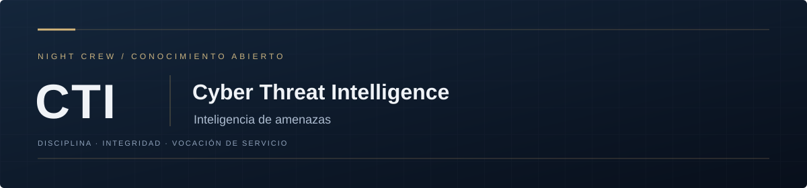

 
 

**Inteligencia de amenazas. Conocimiento al servicio de la seguridad digital.**

[Metodología](docs/METODOLOGIA.md) &nbsp; / &nbsp; [Plantilla](templates/REGISTRO.md) &nbsp; / &nbsp; [Contribuir](CONTRIBUTING.md)

 

## Misión

Transformar información sobre amenazas en conocimiento útil para la prevención y la toma de decisiones. Cada análisis debe distinguir hechos, inferencias y vacíos de información.

## Archivo documental

| Recurso | Finalidad |
| :--- | :--- |
| [Metodología](docs/METODOLOGIA.md) | Criterios de trabajo, validación y revisión. |
| [Plantilla de registro](templates/REGISTRO.md) | Estructura para documentar trabajo y evidencia. |
| [Guía de contribución](CONTRIBUTING.md) | Requisitos de calidad y publicación. |

## Herramientas de apoyo a CTI

El directorio [tools](tools/README.md) reúne checkers y comandos para que los clientes revisen su exposición a vulnerabilidades publicadas y prioricen las acciones de protección.

| Herramienta | Finalidad |
| :--- | :--- |
| [Checker HTTP — CVE-2026-119618](tools/checker-http/README.md) | Revisar indicios de exposición de Apache y verificar la instancia desde Linux. |
| [Checker Outlook — CVE-2026-124194](tools/checker-outlook/README.md) | Comprobar por versión el estado de actualización de Outlook clásico desde PowerShell. |

Los resultados son orientativos y deben contrastarse con los parches del fabricante y la configuración del sistema.

## Principios

Disciplina en el método, integridad en la evidencia y vocación de servicio. Priorizamos la utilidad del conocimiento, el respeto por la privacidad y la colaboración responsable.

---

[CTI](https://github.com/NIGHTCREW-CL/CTI) &nbsp; / &nbsp; [CTH](https://github.com/NIGHTCREW-CL/CTH) &nbsp; / &nbsp; [CTF](https://github.com/NIGHTCREW-CL/CTF) &nbsp; / &nbsp; [EH](https://github.com/NIGHTCREW-CL/EH)

<strong>[NIGHT CREW](https://github.com/NIGHTCREW-CL)</strong> · Institución independiente, sin fines de lucro.

