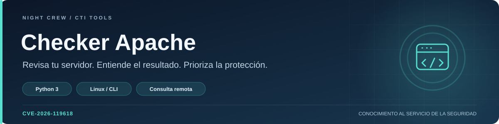
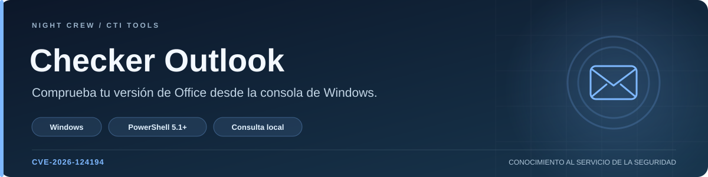

# 🛠️ Herramientas de CTI — NIGHT CREW

**Elige qué necesitas comprobar y sigue la guía de tu equipo.**

Estas herramientas ayudan a los clientes a contrastar su exposición a vulnerabilidades publicadas y priorizar la revisión de sus sistemas. Cada página incluye instrucciones en español, cómo interpretar los resultados y fuentes oficiales.

| 🌐 Servidores Apache | ✉️ Outlook para Windows |
| :---: | :---: |
|  |  |
| **CVE-2026-119618** · Python 3 | **CVE-2026-124194** · PowerShell 5.1+ |
| [Abrir guía de Apache →](checker-http/README.md) | [Abrir guía de Outlook →](checker-outlook/README.md) |

> [!TIP]
> Si tienes acceso por SSH a tu servidor Apache, consulta los [comandos de verificación local en Linux](checker-http/VERIFICACION-LINUX.md) para revisar versión, módulos, protocolos y paquetes desde su propia consola.

### 🚦 Cómo leer los resultados

🔴 **Revisar o actualizar** · 🟡 **Completar la verificación** · 🟢 **Cumple el criterio de versión indicado**

Los resultados se limitan a las evidencias observadas y a las versiones cubiertas. Contrástalos con los avisos del fabricante y la configuración de la instancia. Utiliza los checkers sobre equipos propios o autorizados y revisa cualquier salida antes de compartirla públicamente.

---

[← Volver a NIGHT CREW CTI](../README.md)
