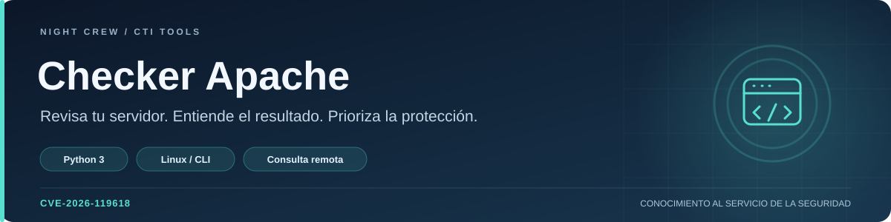

<div align="center">



<br />

[](checker-http.py)
[](#-empieza-aquí)
[](VERIFICACION-LINUX.md)

**Una primera revisión de tu servidor, con pasos claros para saber cómo continuar.**

</div>

## 🔎 ¿Para qué sirve?

Te ayuda a revisar indicios de exposición a **CVE-2026-119618** en Apache HTTP Server. Consulta la versión anunciada y comprueba si el endpoint negocia HTTP/2 mediante TLS/ALPN.

**Necesitas:** Python 3 y un dominio propio o autorizado. Funciona con la biblioteca estándar, sin instalar paquetes de `pip` ni ejecutar como administrador.

> [!NOTE]
> El resultado orienta la revisión. Para confirmar el estado del servidor, contrasta el módulo, la configuración y los parches instalados.

## 🚀 Empieza aquí

### 1. Descarga el checker

Desde tu terminal Linux:

```sh
curl --fail --show-error --location \
  https://raw.githubusercontent.com/NIGHTCREW-CL/CTI/main/tools/checker-http/checker-http.py \
  --output checker-http.py
```

### 2. Revisa el archivo

```sh
less checker-http.py
```

### 3. Comprueba tu dominio

Sustituye `example.com` por tu dominio:

```sh
python3 checker-http.py example.com
```

> [!TIP]
> ¿Tienes acceso por SSH al servidor? La [guía de verificación local en Linux](VERIFICACION-LINUX.md) te permite revisar versión, módulos, protocolos y paquetes desde su propia consola.

## 🚦 Entiende tu resultado

### 🔴 Revisar con prioridad

**Salida:** `POSIBLEMENTE_VULNERABLE`

La versión anunciada está entre 2.4.55 y 2.4.70 y negocia HTTP/2. Comprueba el paquete, el módulo y los parches.

### 🟡 Falta información

**Salida:** `INDETERMINADO`

Verifica localmente. Puede faltar la versión, no comprobarse HTTP/2 o existir un módulo actualizado en un paquete antiguo.

### 🟢 Fuera del rango por versión

**Salida:** `NO_AFECTADO_POR_VERSION_OBSERVADA`

La versión anunciada es posterior al rango upstream. Contrasta el paquete y el origen; este resultado no certifica su seguridad.

### ⚪ Sin conexión

**Salida:** `ERROR_CONEXION`

Comprueba el dominio, el puerto, el acceso de red y el certificado TLS.

<details>
<summary><strong>⚙️ Más opciones y códigos de salida</strong></summary>

```sh
# Puerto específico y detalle de las consultas
python3 checker-http.py https://example.com:8443 --debug

# Salida JSON para revisión interna
python3 checker-http.py example.com --json

# Tiempo de espera por operación y salida sin colores
python3 checker-http.py example.com --timeout 10 --color never

# Ayuda completa
python3 checker-http.py --help
```

Sin esquema se utiliza HTTPS. Aunque indiques una ruta, las consultas se realizan sobre `/` y `/server-status` del host y puerto indicados. `--timeout` acepta un número mayor que 0 y hasta 60 segundos **por operación**, no como límite total. `-k` omite la validación del certificado TLS y debe reservarse para certificados de laboratorio verificados por otra vía.

| Código de salida | Resultado |
| :---: | :--- |
| `0` | `NO_AFECTADO_POR_VERSION_OBSERVADA` |
| `1` | `POSIBLEMENTE_VULNERABLE` |
| `2` | `INDETERMINADO` |
| `3` | `ERROR_CONEXION` |

</details>

<details>
<summary><strong>🧭 Qué comprueba y cuáles son sus límites</strong></summary>

Envía un `HEAD /` y, si no obtiene una versión, hasta dos `GET` a `/server-status`. No sigue redirecciones. La negociación ALPN no envía tramas HTTP/2 ni ejecuta el exploit.

Una cabecera puede estar oculta o modificada. Un proxy puede negociar HTTP/2 mientras el origen usa otro protocolo. El checker no comprueba HTTP/2 sin TLS (`h2c`), módulos externos ni revisiones de paquetes. Un resultado indeterminado o un HTTP/2 no negociado exige revisión local.

</details>

<details>
<summary><strong>🔐 Privacidad y fuente oficial</strong></summary>

El script no incluye credenciales ni objetivos de clientes y no envía telemetría. Solo conserva en memoria el fragmento necesario de `server-status` y muestra la versión extraída; no imprime su contenido operativo. El dominio, la cabecera `Server` y algunos errores pueden aparecer en la salida: revisa y anonimiza cualquier resultado antes de compartirlo. No habilites ni publiques `server-status` para utilizar esta herramienta.

Según el [aviso oficial de Apache](https://httpd.apache.org/security/vulnerabilities_24.html#CVE-2026-119618), el rango upstream afectado es 2.4.55–2.4.70 y la corrección se incluye en 2.4.71. Las distribuciones pueden incorporar módulos y correcciones en versiones distintas: consulta siempre su aviso de seguridad.

</details>

---

<div align="center">

[](../README.md)

[Checker Outlook para Windows](../checker-outlook/README.md) · [NIGHT CREW CTI](../../README.md)

</div>
