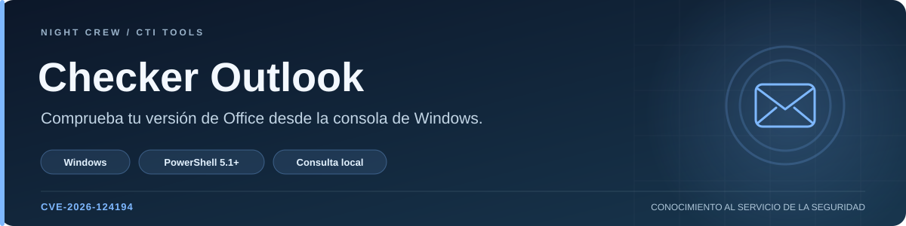

<div align="center">



<br />

[](checker-outlook.ps1)
[](#-empieza-aquí)
[](../README.md)

**Comprueba tu versión de Outlook y entiende qué significa el resultado.**

</div>

## 🔎 ¿Para qué sirve?

Comprueba si la versión instalada de **Outlook clásico para Windows**, mediante Click-to-Run, cumple los umbrales de actualización de **CVE-2026-124194**. Lee el inventario local de Office y comprueba que existe `OUTLOOK.EXE`.

**Necesitas:** Windows, PowerShell 5.1 o posterior y permiso de lectura sobre las claves de Office. Normalmente basta una sesión de usuario.

> [!NOTE]
> La comprobación consulta datos locales. No abre Outlook ni mensajes, no modifica el registro y no instala actualizaciones.

## 🚀 Empieza aquí

### 1. Descarga el checker

Abre PowerShell en la carpeta donde quieras guardar el archivo y ejecuta:

```powershell
Invoke-WebRequest -UseBasicParsing -Uri 'https://raw.githubusercontent.com/NIGHTCREW-CL/CTI/main/tools/checker-outlook/checker-outlook.ps1' -OutFile '.\checker-outlook.ps1'
```

También puedes abrir [el archivo en GitHub](checker-outlook.ps1) y usar **Download raw file**.

### 2. Revisa su contenido

```powershell
Get-Content -LiteralPath '.\checker-outlook.ps1'
```

### 3. Ejecuta la comprobación

```powershell
.\checker-outlook.ps1
```

> [!TIP]
> La descarga requiere Internet; la comprobación funciona localmente. Si la ejecución está bloqueada, sigue la política aprobada por tu organización. Para un servidor Apache en Linux, utiliza el [checker HTTP](../checker-http/README.md).

## 🚦 Entiende tu resultado

### 🔴 Actualización pendiente por versión

**Salida:** `VULNERABLE CVE-2026-124194`

La versión es inferior al umbral de su edición, rama y canal cubiertos. Actualiza y vuelve a comprobar. Es una detección por versión, sin ejecutar el exploit.

### 🟢 Cumple el umbral cubierto

**Salida:** `NOT VULNERABLE CVE-2026-124194`

El inventario cumple la versión de referencia para este CVE. No certifica la seguridad general de Outlook.

### 🟡 Revisión manual necesaria

**Salida:** `UNKNOWN ... DEBUG=...`

Faltan datos o la combinación no está cubierta. Revisa el diagnóstico; `UNKNOWN` no significa protegido.

<details>
<summary><strong>📋 Ediciones, canales y versiones de referencia</strong></summary>

Umbrales publicados por Microsoft el **10 de noviembre de 2026**, contrastados el **13 de noviembre de 2026**:

| Edición / canal | Versión mínima en la rama cubierta |
| :--- | :--- |
| Office LTSC 2024 Volume | `16.0.17932.21140` |
| Office LTSC 2021 Volume | `16.0.14334.21048` |
| Microsoft 365 — Current Channel | `16.0.20527.20196` |
| Microsoft 365 — Monthly Enterprise | `16.0.20527.20194`, `16.0.20430.20264` o `16.0.20326.20320`, según rama |
| Microsoft 365 — Semi-Annual Enterprise | `16.0.20527.20192`, `16.0.20430.20262` o `16.0.20326.20318`, según rama |
| Office 2021 / 2024 Retail | `16.0.20527.20196` |

Si falta el canal de Microsoft 365, se comparan los umbrales mínimo y máximo de los canales cubiertos para la misma rama: una versión intermedia devuelve `UNKNOWN`. Un canal explícito desconocido, una rama distinta o varias familias de Office cubiertas en el inventario también devuelven `UNKNOWN`.

</details>

<details>
<summary><strong>🧭 Alcance, diagnósticos y límites</strong></summary>

No cubre el nuevo Outlook, Outlook web, macOS, instalaciones MSI, Office 2016/2019, canales Preview/Beta ni otras ramas de compilación. No determina si hubo explotación. Tras actualizar, cierra y vuelve a abrir Outlook según el procedimiento de tu organización; el inventario no demuestra qué binario utiliza un proceso que ya estaba abierto.

| Diagnóstico | Qué indica |
| :--- | :--- |
| `SIN_INVENTARIO_C2R` | No se encontró el inventario Click-to-Run. |
| `METADATOS_INVALIDOS` | Los datos de la instalación no permiten realizar la comparación. |
| `OUTLOOK_CLASSIC_NO_CONFIRMADO` | No se pudo confirmar la existencia del ejecutable. |
| `EDICION_*`, `RAMA_*`, `CANAL_*` | La combinación requiere revisión manual. |
| `ERROR_LECTURA_LOCAL` | Hubo un error inesperado. Su contenido se oculta. |

Los resultados son texto en consola; no se definen códigos de salida específicos para automatización. Un proceso terminado con código 0 no significa que Office esté actualizado.

</details>

<details>
<summary><strong>🔐 Privacidad y fuentes oficiales</strong></summary>

El script no lee correos, contraseñas ni tokens, no incluye datos de clientes y no muestra rutas ni URLs del canal. Solo acepta rutas locales con letra de unidad para comprobar el ejecutable; no consulta rutas UNC. No realiza solicitudes HTTP ni incorpora telemetría.

- [Microsoft Security Response Center: CVE-2026-124194](https://msrc.microsoft.com/security-guidance/advisory/CVE-2026-124194).
- [Microsoft: actualizaciones de seguridad de Office](https://learn.microsoft.com/en-us/officeupdates/microsoft365-apps-security-updates).
- [Microsoft: inventario de la versión instalada mediante OfficePackageVersion](https://learn.microsoft.com/en-us/microsoft-365-apps/updates/microsoft-guidance-on-office-build-install).
- [Microsoft: identificadores de canales](https://learn.microsoft.com/es-es/intune/configmgr/sum/deploy-use/manage-office-365-proplus-updates).

</details>

---

<div align="center">

[](../README.md)

[Checker Apache y guía Linux](../checker-http/README.md) · [NIGHT CREW CTI](../../README.md)

</div>
